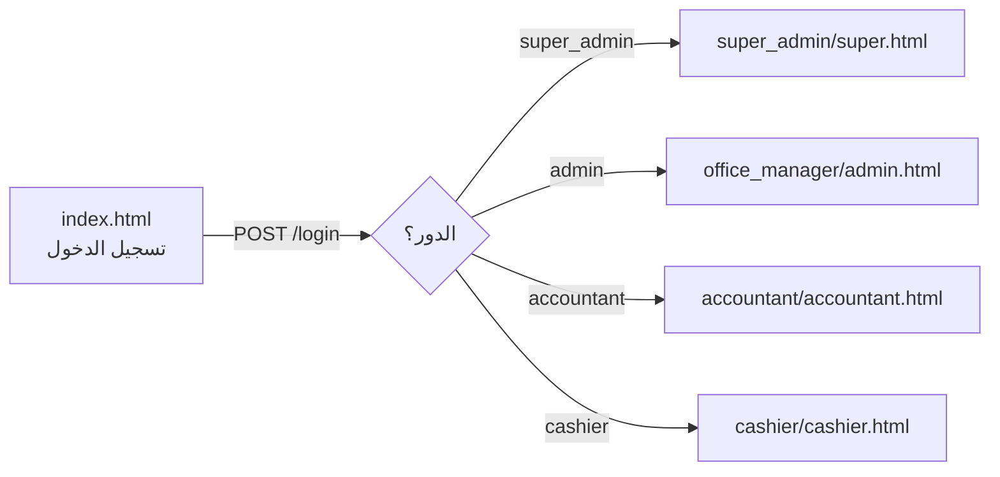

<div align="center">

# ⚡ FlashPay — لوحات الإدارة (Web)

**أربع لوحات تحكم متخصصة لإدارة الحوالات والصناديق والتداول والتقارير.**

<p>
  
  
  
  
  
</p>

[اللوحات](#-اللوحات-حسب-الدور) • [التقنيات](#-التقنيات) • [التشغيل](#-التشغيل-السريع) • [الإعداد](#-ربط-الـ-api) • [البنية](#-بنية-المشروع) • [النشر](#-النشر)

</div>

---

<div dir="rtl">

## 📖 نبذة

واجهة ويب **ثابتة (Static)** بدون أي خطوة بناء، مكتوبة بـ HTML وCSS وJavaScript صرف، تتصل بـ [FlashPay-Back](https://github.com/Ameerdawara/FlashPay-Back) عبر `fetch`. بعد تسجيل الدخول يُحوَّل المستخدم تلقائياً إلى لوحته بحسب دوره.

## 🧩 منظومة FlashPay

| المستودع | الوصف |
|---|---|
| 🖥️ **FlashPay-Front** (هذا المستودع) | لوحات الإدارة على الويب |
| 🛠️ [FlashPay-Back](https://github.com/Ameerdawara/FlashPay-Back) | الـ API — Laravel |
| 📱 [Flash-Pay](https://github.com/ghaiethka-dev/Flash-Pay) | تطبيق الموبايل — Flutter |

## 🔀 مسار الدخول



يُحفظ التوكن في `localStorage` باسم `auth_token`، وتتحقق كل لوحة منه عند الفتح وتعيد المستخدم لصفحة الدخول إن كان غائباً أو منتهياً.

## 🖥️ اللوحات حسب الدور

| الدور | المجلد | الأقسام الرئيسية |
|---|---|---|
| 👑 **المدير العام** `super_admin` | `super_admin/` | لوحة المؤشرات • الحوالات المعلّقة • حوالات البنك • الزبائن • الموظفون • المكاتب • أسعار الصرف • الصناديق • أرباح التداول |
| 🏢 **مدير المكتب** `admin` | `office_manager/` | الحوالات المعلّقة وكل الحوالات • الموظفون • الصناديق • صافي الأرباح • سجل التعديلات • الصناديق الإضافية • حوالات البنك • الحوالات الدولية |
| 🧮 **المحاسب** `accountant` | `accountant/` | الملخص • الحوالات • حوالات البنك • الحوالات الداخلية • الصناديق • التداول • السجلات الرقمية • سجل التعديلات • **الإقفال الشهري** • التقارير |
| 💵 **الصندوق** `cashier` | `cashier/` | الحوالات • الصناديق • أرباح التداول • الحوالات الداخلية • سجل المكتملة • إنشاء حوالة • الزبائن • السجلات الرقمية • حوالات البنك |

كذلك: صفحة **سياسة الخصوصية** (`privacy-policy.html`).

## ✨ مزايا واجهة الاستخدام

- 🌐 **عربية بالكامل (RTL)** بخط Cairo.
- 📱 **متجاوبة**: شريط جانبي قابل للطيّ على الموبايل (`sidebar-mobile.js` + `mobile_*.css`).
- 🔔 إشعارات منبثقة أنيقة (Notyf) ورسوم متحركة (Lottie).
- ⚡ يتذكّر آخر قسم فتحه المستخدم في لوحته.
- ✅ تحقق من المدخلات قبل الإرسال مع رسائل خطأ واضحة وحالة تحميل.
- 🧾 عرض صور الإيصالات والهويات المخزّنة على الخادم.

## 🛠️ التقنيات

| الغرض | الأداة |
|---|---|
| الهيكل والتنسيق والمنطق | HTML5 • CSS3 • JavaScript (ES6+) بلا إطار عمل |
| الأيقونات | [Font Awesome 6.4](https://fontawesome.com) |
| الخط | [Cairo](https://fonts.google.com/specimen/Cairo) (Google Fonts) |
| التنبيهات | [Notyf 3](https://carlosroso.com/notyf/) |
| الحركة | [Lottie / bodymovin 5.12](https://airbnb.io/lottie/) |
| الاتصال بالخادم | `fetch` + Bearer token |

## 🚀 التشغيل السريع

لا يحتاج المشروع إلى `npm install` أو أي بناء. يكفي تقديمه كملفات ثابتة:

```bash
git clone https://github.com/Kaisalafef/FlashPay-Front.git
cd FlashPay-Front

# أي خادم ثابت يكفي، مثلاً:
npx serve .
# أو
python3 -m http.server 8080
```

ثم افتح `http://localhost:8080` وسجّل الدخول بحساب موظف من الـ API.

> 💡 افتح المشروع عبر خادم محلي وليس بالنقر المزدوج على الملف، حتى تعمل طلبات `fetch` وسياسة CORS بشكل صحيح.

## 🔧 ربط الـ API

عنوان الـ API معرّف حالياً في **أعلى كل ملف JavaScript** للوحة:

```js
const API_URL     = "https://api.flashpay.website/api";
const STORAGE_URL = "https://api.flashpay.website/storage";
```

لتشغيل المشروع على خادم آخر (مثلاً بيئة تطوير)، بدّل القيمتين في هذه الملفات:

| الملف | الدور |
|---|---|
| `login/login.js` | تسجيل الدخول |
| `super_admin/super.js` | المدير العام |
| `office_manager/admin.js` | مدير المكتب |
| `accountant/accountant.js` | المحاسب |
| `cashier/cashier.js` | الصندوق |

وتأكد من إضافة نطاق الواجهة إلى إعدادات **CORS** في `FlashPay-Back` (`config/cors.php`).

## 🗂️ بنية المشروع

```
FlashPay-Front/
├── index.html                 # صفحة تسجيل الدخول
├── privacy-policy.html        # سياسة الخصوصية
├── login/
│   ├── login.css
│   └── login.js               # التحقق + التحويل بحسب الدور
├── super_admin/               # super.html • super.js • style_super.css • mobile_super.css
├── office_manager/            # admin.html • admin.js • style_admin.css • mobile_small.css • sidebar-mobile.js
├── accountant/                # accountant.html • accountant.js • style_accountant.css • ...
└── cashier/                   # cashier.html • cashier.js • cashier.css • ...
```

## ☁️ النشر

بما أنه موقع ثابت، يمكن رفعه على أي استضافة:

- **GitHub Pages** — فعّل Pages على الفرع `main`.
- **Netlify / Vercel / Cloudflare Pages** — اربط المستودع بدون أمر بناء، والمجلد الجذر هو `/`.
- **Nginx / Apache** — انسخ الملفات إلى مجلد الموقع.

## 👥 الفريق

| الاسم | الدور |
|---|---|
| قيس العفيف | مهندس برمجيات |
| أمير دوارة | مهندس برمجيات |
| غيث كحل | مهندس برمجيات |
| دلع عدوان | مهندسة برمجيات |

## 📄 الترخيص

مشروع خاص بـ **FlashPay**. جميع الحقوق محفوظة © 2026.

</div>
